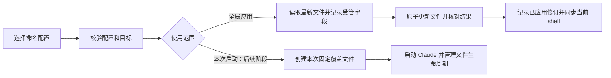

# ccswitch 多配置切换产品方案

日期：2026-10-15

状态：0.6.0 首版已实现并在本机验收；超出首版范围的章节仍为后续设计。

已交付版本：0.6.0。

2026-10-16 范围收敛：0.6.0 先交付命名配置切换和当前配置槽位编辑，每套连接只有一份可编辑组合。`run` 会话隔离、多模型方案及 `--preset` 留到下一阶段；本文相关章节保留为后续设计，不作为首版发布门槛。具体流程和用户案例见[首版落地与用户案例](2026-10-16-ccswitch-mvp-cases.md)。

设计依据：当前 Shells 仓库实现、Claude Code 官方文档、cloudcli-ssh 默认会话中的 2.1.261、本机 2.1.296、临时目录中的发布最新版 2.1.301。2026-10-16 已完成隔离模拟网关与交互终端验证，结果见[配置与兼容验证报告](../research/2026-10-16-claude-config/README.md)。命名配置和槽位编辑首版已交付，详见[本机验收记录](../verification/2026-10-16-ccswitch-local.md)。

## 1. 产品要解决什么问题

用户已经有多套 Claude API 配置，例如公司网关、个人网关、备用网关。每套有自己的地址、认证信息和模型。用户希望保存一次，之后凭名字切换，也能在不同终端同时使用不同配置。

产品定位：**在终端中管理和选择 Claude Code 的 API 配置。**

日常功能收敛为两个入口：**切换配置、编辑槽位**。每套配置独立保存槽位设置，切回时恢复。根据用户 2026-10-16 的范围调整，后续移除 `codex` 专用命令、录入模板和自动检测，所有连接按名称统一管理。

首次录入后，日常操作如下：

```bash
ccswitch add work             # 录入一套配置，之后可以反复使用
ccswitch use work             # 将 work 应用为当前配置目录的全局配置
ccswitch slots                # 编辑已识别的当前配置的槽位
```

`ccswitch use` 不填名称时打开配置选择器；`ccswitch slots edit work` 可直接指定编辑对象。按次启动和多模型方案属于下一阶段能力。

第一版按“多套 API 网关、密钥、模型，复用现有 Claude 使用环境”设计。不同官方登录账号的完整隔离单独规划，见第 12 节。这是本稿的范围假设。

## 2. 当前实现与产品缺口

| 当前行为 | 对用户的影响 | 新方案的处理 |
| --- | --- | --- |
| 仅支持 `default`、`codex` 两个端点 | 第三套配置没有自然入口 | 配置按名称保存，数量不设产品限制 |
| `init` 总是写入同一份 `ccswitch-defaults.json` | 多次保存会替换恢复点 | 命名保存；同名替换必须显式指定 |
| 快照只记录 `ANTHROPIC_AUTH_TOKEN`，恢复时删除 `ANTHROPIC_API_KEY` | API Key 配置不能完整往返切换 | 显式保存认证类型和认证值 |
| 切换同时修改全局文件和当前 shell | 多终端使用不同配置时容易互相覆盖 | 首版说明共享范围，下一阶段增加按次启动隔离 |
| 默认模型目录和槽位绑定 CloudCLI | 自定义网关容易被套用错误模型规则 | 模型和目录来源归属于配置 |
| 状态主要展示文件内容和一个 profile 名 | 文件、shell、保存值不一致时难以判断 | 展示全局应用记录、文件偏差和当前 shell 冲突 |
| 路径固定为 `~/.claude` | 设置了自定义配置目录时可能改错位置 | 操作开始时解析 `CLAUDE_CONFIG_DIR`，展示实际目标 |

代码证据：`ccswitch/lib/ccswitch_backend.py` 的 `SNAPSHOT_KEYS`、`cmd_init`、`cmd_codex`、`cmd_default`；两份 shell 包装函数；`ccswitch/README.md` 的设计取舍。

需要更新旧产品表述：不能笼统宣称“修改配置只影响重启后的 Claude”。官方文档说明部分文件设置会热加载，变量从文件移除也不等于从已运行进程中移除。全局切换可能影响已有会话，具体取决于 Claude 版本和设置项。[官方配置说明](https://code.claude.com/docs/en/settings#when-edits-take-effect)、[环境变量说明](https://code.claude.com/docs/en/env-vars#precedence)

## 3. 方案选择

| 方案 | 使用体验 | 主要代价 | 适用性 |
| --- | --- | --- | --- |
| A：命名配置，应用到全局文件 | 切换后直接输入 `claude`，符合现有习惯 | 全局文件由多个终端共享 | 作为日常默认入口 |
| B：命名配置，启动时传入会话配置 | 不同终端可各选一套，退出后无需还原 | 必须通过 `ccswitch run` 启动 | 下一阶段交付 |
| C：每套配置使用独立 Claude 目录 | 可以进一步隔离登录、会话和插件 | 要分别登录和维护各目录 | 用于后续完整账号隔离 |

**推荐首版交付 A，下一阶段用同一份配置库增加 B。** 每套配置先维护一份槽位组合，降低首次使用成本。C 独立演进。用户如果必须同时运行两套连接，需要等 B 交付后再获得这一承诺；两个终端分别执行 `use` 仍然共享全局文件。

已有桌面产品 [farion1231/cc-switch](https://github.com/farion1231/cc-switch) 提供图形化服务商管理和更多客户端能力，可以作为需要桌面管理时的选择。本项目继续面向当前 shell 工作流，第一版聚焦命名配置和切换范围。

## 4. 一套配置包含什么

配置名称标识一组可以直接使用的连接和模型设置，例如 `work`、`personal`、`backup`。

| 内容 | 含义 | 示例 |
| --- | --- | --- |
| 名称 | 命令中使用的稳定标识 | `work` |
| 显示名称 | 菜单中的中文或其他名称，可选 | 公司网关 |
| API 地址 | 完整 Base URL，保留用户提供的路径 | `https://gateway.example.com/anthropic` |
| 认证方式 | API Key 或 Bearer Token | `api_key` / `bearer_token` |
| 认证值 | 对应认证方式的密钥 | 本机保存，显示时脱敏 |
| 默认模型方案 | 首版内部固定的一份槽位组合 | 内部名称为 `default`，界面无需用户命名 |
| 模型方案 | 默认启动模型、运行档位、子代理策略及菜单候选 | 首版每套连接一份；后续支持多份 |
| 模型目录来源 | 手动维护或 CloudCLI | `manual` / `cloudcli` |
| 元数据 | 创建、更新、修订信息及导入来源类型 | 不包含导入文件正文 |

录入模板只负责提供初始值：通用 Anthropic 兼容网关、CloudCLI。创建后，这些都是普通配置，用户可以编辑其中的模型。新配置自动包含一份内部 `default` 模型方案，首版不提供创建第二份的入口。

当前支持的网关协议为 Anthropic Messages。目标地址必须提供兼容接口；需要模型协议转换时由网关完成。

权限、hooks、MCP、插件、skills、会话和普通超时配置由 Claude 原有配置管理。导入完整 `settings.json` 时只提取本产品管理的连接及模型字段，并告诉用户提取结果。

认证类型必须明确：API Key 写入 `ANTHROPIC_API_KEY`，Bearer Token 写入 `ANTHROPIC_AUTH_TOKEN`。两者用途不同，不能自动互换。[官方认证说明](https://code.claude.com/docs/en/authentication#authentication-precedence)

### 4.1 名称与保存规则

- 名称为 1～48 位小写字母、数字、短横线、下划线，以字母或数字开头；中文用于显示名称。
- 名称不得与命令关键字冲突；`default` 允许作为迁移配置名称，通过 `use <name>` 选择。
- `add`、`save`、`import` 遇到同名配置默认失败，使用 `--replace` 才能替换。
- 保存、导入、编辑只更新配置库。应用配置必须执行 `use`，或在录入结束后明确选择“保存并应用”。
- 编辑正在应用的连接字段或模型方案后，状态显示“保存值已更新，尚未重新应用”，避免把保存成功误报为切换成功。编辑同一配置下未应用的其他方案不会产生这条提示。

### 4.2 认证和模型完整性

每次应用都生成完整的受管字段集合：当前认证类型有值，另一认证类型明确清空；各模型槽位按该配置设置，没有配置的旧槽位也必须被中和。

模型编辑器提供“统一填充”和“分别设置”：统一填充将运行档位设为同一模型，分别设置允许各档独立配置。菜单候选单独维护。通用模板默认统一填充，CloudCLI 模板提供分档初值。

模型 ID 按配置的网关规则处理。CloudCLI 可以使用专属模型目录；自定义网关不能被 CloudCLI 的目录拒绝。`[1m]` 作为模型标识的一部分保留，只有明确支持相应规则的模板才提供自动补全。

第一版支持静态 API Key 和 Bearer Token。遇到同时存在两种认证值时必须让用户选定一种；遇到 `apiKeyHelper`、云服务商认证或原生登录配置时给出具体原因，禁止默默转换为另一种认证方式。

受管字段分为以下三组，必须在所有入口共用同一份清单：

| 字段组 | 处理范围 |
| --- | --- |
| 连接与静态认证 | `ANTHROPIC_BASE_URL`、`ANTHROPIC_API_KEY`、`ANTHROPIC_AUTH_TOKEN` |
| 模型 | 顶层 `model`、`modelPicker`，现有 `MODEL_KEYS`、`CUSTOM_OPTION_KEYS`，以及已识别的新档位字段和会影响启动模型的 `ANTHROPIC_DEFAULT_MODEL` |
| 冲突认证来源 | 检查 `CLAUDE_CODE_USE_BEDROCK`、`CLAUDE_CODE_USE_VERTEX`、`CLAUDE_CODE_USE_FOUNDRY`、`CLAUDE_CODE_OAUTH_TOKEN` 和 `apiKeyHelper` 等来源 |

对于冲突来源，只有经验证可以中和的环境变量才纳入显式中和清单；不能可靠中和的配置返回具体冲突。登录凭据文件和系统密钥环由 Claude 自己管理。

模型字段注册还需覆盖已支持档位的 `_MODEL_NAME`、`_MODEL_DESCRIPTION`、`_MODEL_SUPPORTED_CAPABILITIES`，以及旧 Custom 的 `ANTHROPIC_CUSTOM_MODEL_OPTION_SUPPORTED_CAPABILITIES`。导入时保留这些已识别值，应用另一方案时完整处理，防止前一方案的名称或能力声明残留。第一版普通编辑流程仍以选择模型为主，不自动为未知模型声明能力。`modelPicker` 行的 `behavesAs` 也属于需按客户端能力保留的高级字段，不改变发送给网关的实际模型 ID。

### 4.3 槽位作为模型方案管理

内部结构为“连接配置 → 模型方案 → 槽位映射”。首版每套连接只编辑一份组合，用户直接理解为“这套配置的槽位”。下面的多方案示例属于下一阶段：同一网关需要两套模型组合时，复制一份方案即可，密钥只在连接配置中维护。

```text
work：公司网关，地址与认证共用
  default：默认方案
    启动选择 → 跟随 Sonnet
    Opus     → claude-opus-5[1m]
    Sonnet   → claude-sonnet-5[1m]
    Haiku    → qwen3.8-max
    子代理   → 跟随主会话，尊重 agent 自己的模型设置
    菜单候选 → DeepSeek V4Pro 等
  economy：用户创建的另一份组合
    启动选择、各档位与菜单分别保存

personal：个人网关，维护自己的模型方案
```

示例模型沿用本仓库已有配置，用于说明结构；实际可用性由该网关决定。`economy` 等名称由用户命名，产品不会仅根据方案名判断费用。

#### 槽位、启动选择和菜单的职责

| 项目 | 产品含义 | 编辑规则 |
| --- | --- | --- |
| Opus | `opus` 档位映射 | 选择该网关接受的模型 ID |
| Sonnet | `sonnet` 档位映射 | 独立设置，不随启动模型的临时选择改变 |
| Haiku | `haiku` 档位映射及相应后台用途 | 独立设置，不拿来安放纯粹为了菜单展示的额外模型 |
| 默认启动选择 | 新会话从哪个档位或具体模型开始 | 可选择“跟随某档位”或“固定模型” |
| 子代理默认策略 | 没有更高优先级模型指定时采用什么 | 跟随主会话、使用某档位、固定模型 |
| 菜单候选 | `/model` 中供用户手动选择的其他模型 | 可命名、排序、添加和删除，数量不固定为一个 |
| small fast | 历史配置兼容字段 | 默认折叠到兼容设置，不作为第七个常规槽位 |

Opus、Sonnet、Haiku 的映射及 Custom 单菜单项由官方模型配置定义。[模型配置说明](https://code.claude.com/docs/en/model-config#environment-variables)

默认启动选择必须使用明确的引用类型。选择“跟随 Sonnet”后，调整 Sonnet 映射会影响下次应用或启动；选择“固定模型”则保持该模型不变。引用不能把用户自定义模型 ID 恰好与槽位同名的情况误判为槽位引用。

运行档位本身只绑定模型 ID 或明确的“使用客户端默认”；引用仅允许出现在启动选择、子代理策略和菜单中，因此不会出现槽位之间的循环引用。“使用客户端默认”必须清理本工具上次写入的映射，并在界面中显示该状态，不能解释成沿用上一份方案。通用网关模板优先显式填满基础档位，减少请求落到网关不支持的默认模型。

子代理策略是默认值。agent 定义或调用时显式指定的模型可能拥有更高优先级；界面说明这一点，第一版不自动启用强制覆盖。`ANTHROPIC_SMALL_FAST_MODEL` 已弃用，由 Haiku 映射承担新配置的对应职责。导入的独立旧值仍保存并标记为兼容项，用户明确选择“与 Haiku 同步”后再合并。[官方变量说明](https://code.claude.com/docs/en/env-vars)

检测到已有 `CLAUDE_CODE_SUBAGENT_MODEL_FORCE` 时必须显示它对策略的影响。导入时将其作为兼容字段记录；新建方案默认关闭强制覆盖，应用时也需要处理该已知字段，避免上一方案的强制设置悄悄改变“跟随主会话”的含义。

其他官方档位通过扩展字段注册，已识别的 Fable 等档位可在客户端支持且导入或主动配置时展示。`opusplan` 这类组合模式作为启动选项处理，沿用其依赖的档位，不制造一套重复映射。

#### 客户端概念和数量边界

本产品管理的是终端中的 Claude Code。这里的档位是模型别名的映射；菜单项是手动选择入口；连接配置才保存地址和密钥。这三种数量不能合并成一个“槽位数”。不将本方案直接承诺为 Claude 桌面聊天客户端的配置能力。

| 对象 | 数量边界 | 用户应如何理解 |
| --- | --- | --- |
| 命名连接配置 | 产品不设人为数量上限 | 可以保存 work、personal、backup 等多套地址和认证 |
| 每个连接的模型方案 | 首版一份；后续多方案不设人为数量上限 | 首版直接编辑该连接的槽位 |
| 基础档位映射 | Opus、Sonnet、Haiku 各一个映射；其他官方档位按客户端能力扩展 | 不能任意新增十个自定义别名并期待 Claude 自动识别 |
| 主会话当前模型 | 一个当前选择 | 配置多个档位不会自动按题目难度选模型；选择别名后能跟随该档位的热更新，固定模型 ID 则保持当前选择 |
| 子代理默认策略 | 一条默认策略 | 不代表只能启动一个子代理，具体 agent 还可能有自己的模型指定 |
| 旧式 Custom 菜单项 | `ANTHROPIC_CUSTOM_MODEL_OPTION` 额外提供一个 | 这是旧菜单入口的限制，不是 Claude 总共只能用四个模型 |
| 新式菜单候选 | `modelPicker.options` 支持多项，官方未公布固定项数上限 | 2.1.261、2.1.296、2.1.301 均验证 12 项展示及第 13 项热新增；2.1.301 数组校验未设项数上限，但不能宣称无限容量 |

数量多时，产品选择器每页显示 10 项，提供关键词筛选和前后翻页；这是每页展示数量，不限制保存总数。Claude 自己的 `/model` 菜单交互由客户端负责。配置文件大小、终端性能以及客户端和网关的可用性限制仍适用，容量承诺不能写成“无限个”。[官方模型菜单字段](https://code.claude.com/docs/en/settings-reference#modelpicker)

Opus、Sonnet、Haiku 的名称不保证绑定的模型具备对应能力。将 Haiku 指向某个通用模型，只改变请求的目标 ID，不会自动补齐它对工具调用或其他协议功能的支持。多个菜单项也不会自动创建多个并行运行的模型。

#### `/model` 菜单适配

槽位映射控制模型选择的含义，菜单控制用户可以方便地看到哪些选项。新版 Claude 提供 `modelPicker` 以添加多条有名称、有顺序的菜单项，旧版 `ANTHROPIC_CUSTOM_MODEL_OPTION` 则只有一条。[官方自定义菜单说明](https://code.claude.com/docs/en/model-config#add-a-custom-model-option)

`modelPicker` 要求 Claude Code 2.1.242 或更新版本。本机 2.1.296 满足这一版本条件。从当前方案生成菜单时，默认保留 Claude 自带菜单并追加候选；用户可以明确选择替换内置选项。候选支持引用档位或指定模型 ID，展示时同时显示名称和解析后的模型。

替换模式仍保留客户端的 Default 行，以及必要的会话当前模型行，不能预览成只有用户填写的几行。追加模式下，客户端会跳过已经由内置菜单覆盖的模型；若用户希望给这些行重新命名或排列，编辑器提示改用替换模式。组织 `availableModels` 限制仍然有效，客户端也可能隐藏或禁用不可用项；“已保存候选”与“客户端一定显示且可调用”必须区分。[官方菜单行为说明](https://code.claude.com/docs/en/settings-reference#modelpicker)

旧版客户端保留三个基础档位，并允许用户指定一个候选作为 Custom 项。其他候选继续保存在产品中，界面标记“当前客户端无法全部显示”；启动时可以显式指定模型。产品不把多个候选塞进一个变量，也不静默丢弃保存值。

菜单里的多个模型共用当前连接配置的地址和认证。若 Opus 与 Haiku 要分别访问不同服务商，由统一网关完成路由；模型方案本身不为每个槽位切换 API 地址。

#### 配置与应用规则

以下第 1、4、5、6 项用于首版；涉及 `--preset`、`run` 和方案管理的其余规则在下一阶段启用。

1. `use work` 使用 work 的默认方案，同时应用连接、档位、子代理策略、菜单和启动选择。
2. `use work --preset economy` 只为此次全局应用选择 economy，保留 work 原来的默认方案指向。
3. `run work --preset economy -- --model <id>` 只覆盖该次会话的初始主模型，其余档位仍来自 economy。
4. 切换方案后使用目标方案的完整映射，清理前一方案残留的菜单和模型变量。
5. 在 Claude 内执行 `/model` 沿用 Claude 原生行为，不自动把修改写回命名方案；需要保存时通过本产品的保存入口明确选择目标。
6. `save new-name` 创建新连接配置，并把提取到的模型设置放入其 `default` 方案；它不会覆盖其他配置里的任何方案。
7. 从全局文件保存回已有连接的模型方案，使用 `slots save <profile> --preset <name>`；只提取模型字段，遇到已有方案时要求 `--replace`。

下一阶段，方案默认指向通过 `preset default <profile> <name>` 修改，只影响后续省略 `--preset` 的调用；它不自动切换已经应用的配置。删除默认方案或任一目标目录正在应用的方案时，要求先修改指向或切换方案。历史撤销记录和已运行的固定覆盖不依赖原方案继续存在。

#### 槽位编辑界面

```text
连接：work / 公司网关
状态：已应用；编辑中

1. 启动模型
   跟随 Sonnet → claude-sonnet-5[1m]
2. 运行档位
   Opus       claude-opus-5[1m]
   Sonnet     claude-sonnet-5[1m]
   Haiku      qwen3.8-max
3. 子代理默认
   跟随主会话，尊重 agent 显式设置
4. 手动模型菜单
   保留内置项；追加 1 项：DeepSeek V4Pro
5. 兼容设置（折叠）

操作：选分区编辑 / 统一填充 / 查看变更
完成：保存 / 保存并应用 / 取消
```

编辑流程遵循“在草稿中修改 → 查看影响 → 保存或应用”，进入分区不会马上改全局文件。

1. 编辑启动模型时，先选“跟随档位”或“固定模型”。跟随档位显示当前解析值；固定模型可从目录选择，也可手填网关模型 ID。从某个菜单候选选取固定模型时保存其实际 ID，不建立对菜单行的隐藏依赖。
2. 编辑运行档位时，先选 Opus、Sonnet 或 Haiku，再选目录中的模型或手填 ID。基础档位行固定存在；恢复客户端默认是显式选项，需要提示它将清理现有映射。选错可以回退草稿，不能用空输入误触清空。
3. 编辑子代理默认时提供“跟随主会话 / 指定档位 / 固定模型”三选一，并明确这是默认策略。强制覆盖仅在兼容设置中解释已有状态，不在普通流程中推荐开启。
4. 编辑手动菜单时提供“添加 / 修改 / 上移下移 / 删除 / 展示方式”。每行有显示名称、目标类型、档位或模型 ID、可选说明。名称用于显示，模型 ID 用于请求；二者不可混用。新增候选默认固定 ID，用户也可明确改为跟随档位。

例如，只想在 `/model` 里增加 DeepSeek：进入“手动模型菜单 → 添加”，填写显示名和实际 ID，再保存；Opus、Sonnet、Haiku 和启动选择都不会因添加入口而改变。若把 Haiku 映射改成另一模型，则预览应提示它可能影响客户端选择 Haiku 的用途以及引用 Haiku 的子代理或菜单项。

```text
编辑 Sonnet 档位
原值：claude-sonnet-5[1m]
新值：gateway-sonnet-v2

会随之更新：
  启动模型：跟随 Sonnet → gateway-sonnet-v2
  菜单“日常编程”：跟随 Sonnet → gateway-sonnet-v2

保持固定：
  菜单“旧版对照”：固定 claude-sonnet-5[1m]

返回继续编辑 / 接受本次修改
```

以上新 ID 仅为演示。编辑器校验必填项、引用是否合法、菜单解析结果和当前客户端能力；未出现在可取得目录中的模型标记“未验证”，不能套用其他网关目录直接拒绝。保存不发起模型推理，也不把本地校验成功显示成模型调用成功。

删除菜单行仅移除快捷入口，不改变启动模型、档位映射或该模型的网关可用性。菜单中跟随档位的行在档位更新后一起解析；固定 ID 的行保持原值。解析到重复模型时给出提示，避免用户把同模型的不同名字误认成不同能力。

退出编辑前显示相对已保存方案的变更摘要。“保存”只更新配置库；“保存并应用”先保存，再执行一次全局应用。若应用失败，明确显示“方案已保存，应用失败”及原因；“取消”放弃本次草稿。已在运行的会话不能被标为已经切到新模型，实际变化仍由 Claude 自身的优先级和热加载行为决定。

“统一填充”修改当前正在编辑的方案，预览受影响档位后再保存；不批量更改其他连接或其他方案。下一阶段的“复制方案”只复制槽位和模型设置，目标仍属于同一连接。跨连接复用时需要重新核对目标网关的模型 ID，不能据名称假定通用。

查看槽位时显示保存值、目标档位解析值和当前已应用值。该方案尚未应用时明确显示状态；首版显示“work / 启动跟随 Sonnet”，下一阶段再增加方案名称。

## 5. 命令与交互

### 5.1 核心命令

| 命令 | 行为 |
| --- | --- |
| `ccswitch` / `ccswitch status` | 显示当前目标目录、全局配置和偏差；保留无参数查看状态的习惯 |
| `ccswitch list` | 列出保存的配置，标记全局当前项和配置完整性 |
| `ccswitch use` | 在交互终端中选择并应用；非交互环境要求明确名称 |
| `ccswitch use <name>` | 应用该配置的连接和槽位，同步当前 shell |
| `ccswitch slots` | 交互编辑已识别的全局当前配置；身份不明时要求选择对象 |
| `ccswitch slots <name>` | 查看指定配置的槽位 |
| `ccswitch slots edit <name>` | 交互编辑指定配置的槽位 |
| `ccswitch add <name>` | 向导录入地址、认证和模型 |
| `ccswitch save <name>` | 从当前目标目录的用户 `settings.json` 提取并保存 |
| `ccswitch import <name> --from <file>` | 从已有 Claude settings 文件或本产品配置文件导入一套配置 |
| `ccswitch edit <name>` | 向导编辑配置；回车保留原值，密钥默认不显示 |
| `ccswitch remove <name>` | 删除保存的配置；被任一已记录目录作为全局当前项引用时拒绝删除 |
| `ccswitch undo` | 撤销最近一次成功的全局应用，恢复该次应用前的受管字段 |
| `ccswitch doctor [name]` | 做本地完整性、路径、版本能力和配置冲突检查 |

首版日常入口为 `use` 和 `slots`。`slots` 通过目标目录的应用记录和受管字段摘要确认当前项；尚未迁移、文件偏离或无法确认时显示来源差异并要求用户选定对象，不能猜测后覆盖配置库。非交互环境要求显式对象，不能等待输入。保存前始终展示对象和变更摘要。

以下命令和参数留到下一阶段：

| 命令 | 行为 |
| --- | --- |
| `ccswitch use work --preset <方案>` | 应用连接及所选模型方案 |
| `ccswitch run <name> [--preset <方案>] -- [Claude 参数]` | 用指定连接及模型方案启动一次 Claude |
| `ccswitch slots work --preset <方案>` | 查看指定模型方案 |
| `ccswitch slots edit work --preset <方案>` | 编辑指定模型方案 |
| `ccswitch slots save work --preset <方案>` | 从目标目录的用户 settings 提取模型字段保存为方案；同名要求 `--replace` |
| `ccswitch preset copy work default economy` | 在 work 内复制一份模型方案 |
| `ccswitch preset default work economy` | 修改 work 的默认模型方案指向 |
| `ccswitch preset remove work economy` | 删除未作为默认且未被应用的方案 |

`models [name]` 显示指定配置的目录；省略名称时使用已识别的全局当前配置。全局状态不明时要求指定名称，不能默认查询 CloudCLI。`help`、`version`、`update` 继续存在。

名称补全只展示名称和显示名称，不把地址参数或密钥写进 shell 历史。向导密钥输入不回显，基础菜单只依赖 Python 标准库，支持数字选择、Enter 确认和取消；取消不产生写入。

### 5.2 典型使用过程

用户已有三份 settings 文件：

```bash
ccswitch import work --from ~/configs/claude-work.json
ccswitch import personal --from ~/configs/claude-personal.json
ccswitch import backup --from ~/configs/claude-backup.json
ccswitch list
ccswitch use work
claude
```

下一阶段的两个终端并行入口（首版未交付）：

```bash
# 终端 A
ccswitch run work

# 终端 B
ccswitch run personal -- --model my-model
```

命令行显式传入的 `--model` 只修改本次启动的模型。它不改写保存配置，模型槽位仍来自所选配置。

从正在使用的全局配置保存一份：

```bash
ccswitch save work
```

这里的“当前”明确指目标目录的用户 settings 文件。不会猜测某个已运行 Claude 的状态，也不会让旧 shell 中的导出值静默覆盖文件。若缺少认证信息，向导要求补充或提示先用 `add` 录入；非交互环境直接报缺失字段。

### 5.3 第一次录入和已有文件导入

`add work` 的向导按以下顺序进行：选择模板、填写地址、选择认证方式、输入密钥、设置当前模型、选择单模型或分档模式，最后展示脱敏摘要。模板、模型槽位等有默认值的选项可以直接回车。

新建时将模型填写结果放入内部 `default` 方案，用户不必填写方案名称。最终动作提供“保存”“保存并应用为全局配置”“取消”，默认是保存。只有最后确认动作发生时才写入；保存完成后给出 `use`、`slots edit` 的可复制命令。

`import` 显示提取出的地址主机、认证类型、模型及忽略的非受管字段名称。若同时发现两种认证，交互环境要求选择；脚本可以用 `--auth api_key` 或 `--auth bearer_token` 明确选择。它不显示密钥正文，也不执行导入文件中的脚本。

包含有效连接或认证字段但信息不全的文件可以导入为“需补充”配置，后续通过 `edit` 补齐；`use`、`run` 拒绝使用不完整配置。完全没有连接或认证信息的文件直接报“未发现 API 配置”，避免生成无意义的空项。

### 5.4 菜单和状态示意

```text
选择全局配置
目标：/home/you/.claude/settings.json

  1. work       公司网关       gateway.example.com   当前
  2. personal   个人网关       personal.example.com
  3. backup     备用网关       backup.example.com

输入序号，Enter 确认；q 取消
```

菜单只显示地址的主机部分，不显示可能含有认证信息的 URL 查询串。不能把“配置完整”显示成“服务在线”。

```text
全局当前：work
启动选择：跟随 Sonnet
目标目录：/home/you/.claude
配置修订：4，已应用
当前文件：与应用记录一致
配置中的启动模型：work-model
认证方式：Bearer Token，已配置
当前 shell：发现旧的模型变量，可能影响后续直接启动

重新应用：ccswitch use work
编辑槽位：ccswitch slots
```

`status` 只能描述可检查的配置来源，不能宣称知道其他终端里某个运行中 Claude 的实际状态。若文件被手动更改，显示“全局文件已修改”，展示受影响字段名和脱敏摘要。

## 6. 两种使用范围的明确承诺

首版只交付 `use` 的全局应用。下表中的 `run` 用于下一阶段的会话隔离设计；首版不承诺两个终端可以各用一套连接。

| 维度 | `use work` | `run work` |
| --- | --- | --- |
| 保存的 work 配置 | 读取 | 读取 |
| 全局 settings 文件 | 应用受管字段 | 启动器不写入 |
| 当前 shell 的受管变量 | 同步更新 | 启动器不修改父 shell |
| 新开终端直接执行 `claude` | 默认读取已应用的用户配置，仍受其他来源影响 | 按原有全局配置启动 |
| 运行中的其他 Claude | 可能因热加载受到影响 | 保持本次启动指定的连接和模型字段覆盖 |
| 本次 Claude 退出后 | 全局应用继续存在 | 没有临时全局切换需要还原 |
| 会话、插件和项目环境 | 沿用当前 Claude 目录与项目 | 沿用当前 Claude 目录与项目 |

`run` 的隔离范围是本次启动的连接和初始模型字段，不等于完整账号、文件访问或会话存储隔离。Claude 自己执行 `/model`、`/config` 或 hooks 后产生的原生写入，仍遵循 Claude 行为。

### 6.1 动态生效的范围

全局应用优先利用 Claude 原生文件热加载，避免将所有修改一律解释为必须重启。客户端会把 settings 中新增或修改的 env 值重新应用到进程环境；删除字段不会清除已运行进程的旧值，因此切换时仍需完整处理已知冲突字段。[官方环境变量热加载说明](https://code.claude.com/docs/en/env-vars#set-variables-in-settings-files)

| 用户动作 | 对运行中会话的承诺 |
| --- | --- |
| 在 Claude 内执行 `/model` | 原生支持当前会话切换模型，无需重启，仍受可用性和组织限制约束 |
| 修改 settings 顶层 `model` 或 env 的 `ANTHROPIC_MODEL` | 三版实测均不会因此改变运行中已选主模型；切换当前会话仍使用 `/model` |
| 修改当前选中的别名档位 | 三版实测能在热加载后改变后续请求目标；当前选择固定 ID 时不跟随档位更新 |
| 应用菜单、地址和 Token | 三版已验证原生热加载及实际后续请求变化；菜单重新打开后展示新增项 |
| Bearer Token 与 API Key 互转 | 2.1.261、2.1.296 已验证显式清空旧认证后正确互转；仅删除旧字段会残留，不能用于热切换 |
| 只编辑保存方案而未应用 | 不修改运行环境，不触发客户端配置变更 |
| 修改启动时专属的覆盖配置所引用的保存方案 | 不影响已经固定启动的 run 会话，保持其原有隔离约定 |

产品输出首先报告“全局配置已更新”，随后提示当前会话需要的动作；没有运行会话反馈或请求证据时，不显示“当前会话已切换”。主模型属于官方注明的启动时读取项，切换当前模型使用 `/model`。[官方设置生效范围](https://code.claude.com/docs/en/settings#when-edits-take-effect)

本机稳定会话的观测中，写入后 0.2 秒的请求仍可使用旧值，约一秒后已更新；启动阶段也出现过修改后首个请求仍使用旧配置。因此不承诺“命令返回后下一条请求必已切换”，不以固定 sleep 作为生效证明。已有请求不迁移到新网关。真实用户的 hooks、组织管理、项目覆盖和不同版本仍需分别检查；本次隔离测试没有执行用户的 hooks 或插件。

推荐使用方式：新方案默认通过别名选择启动档位。用户在 Claude 中选择 `/model sonnet`、`/model opus` 等后，后续修改该档位映射可以热生效。全局切换保持运行中已选档位，不强制把当前会话改成目标方案的启动默认值。旧配置中的固定 ID 原样保留；需要跟随档位时由用户明确选择一次别名，不能为了热更新在迁移时偷偷改写。

若目标 Claude 版本没有通过相应验证，应提示重新选择模型或重启，不能以文件已写入替代验证。第一版沿用 Claude 原生机制，不为动态生效新增代理服务。

### 6.2 按次启动如何成立（下一阶段）

Claude 支持使用 `--settings <file>` 为单个会话提供覆盖配置，并保留未指定字段的其他来源值。[官方 CLI 说明](https://code.claude.com/docs/en/cli-reference#cli-flags)

因此 `run` 应执行以下流程：

1. 读取所选配置，生成该次启动独有的设置文件。
2. 对连接、认证和模型受管字段给出完整值，包括对其他来源残留值的显式中和。
3. 清理子进程继承的冲突变量，并以 `claude --settings <本次文件>` 启动。
4. 文件在整个受管理进程生命周期内保持不变；编辑原配置或执行另一终端的 `use` 不会重写该文件。
5. 前台进程退出后清理文件，保留 Claude 的退出码和信号行为。

组织 managed 设置仍遵循 Claude 的优先级。发现 managed 限制、宿主接管或不支持的认证来源会使目标配置无法应用时，应解释冲突并停止，不能显示“切换成功”。[官方配置优先级](https://code.claude.com/docs/en/settings#settings-precedence)

下一阶段的按次启动先支持正常前台交互和 `-p`。后台、daemon、cloud、desktop 等可脱离启动器的执行入口不包含在其生命周期承诺内；检测到这些参数时给出说明，避免主进程退出后删除仍在使用的覆盖文件。

该阶段对用户另行传入 `--settings`、`--setting-sources`、`--bare` 返回明确的参数冲突说明。这些选项会改变覆盖或认证语义，需要后续单独定义组合规则。普通 `--model`、`--resume`、`--continue`、`-p` 等参数正常透传。

多终端验收必须验证实际解析出的目标地址、认证方式和模型，不能只根据参数已经生成就判定隔离成功。缺少所需覆盖能力的 Claude 版本可以继续使用全局应用，但按次启动必须明确报不支持。

## 7. 配置库与应用记录

建议使用独立于 Claude 目录的本机配置库：

```text
~/.config/ccswitch/              # 设置 XDG_CONFIG_HOME 时使用其对应路径
  profiles/
    work.json
    personal.json
    backup.json
  state/
    targets.json                # 各 Claude 目标目录的应用记录
  backups/
    <target-id>/                 # 最近 10 次受管字段恢复记录
```

每份配置有 schema 版本和修订号。配置库目录权限为 `0700`，包含认证信息的文件为 `0600`；第一版按本机文件保存密钥，界面说明保存位置。普通输出和 JSON 查询结果均对密钥脱敏。

`targets.json` 按目标目录的规范绝对路径记录配置名称、模型方案名称、已应用的配置修订、本次模型等覆盖值、受管字段摘要及操作编号。保存值是否待应用通过连接字段和所选方案的有效内容判断；其他方案的编辑不会制造虚假的待应用状态。`CLAUDE_CONFIG_DIR` 未设置时目标为 `~/.claude`；设置时使用其绝对路径。各目录分别记录状态，防止把 A 目录的“当前配置”误报到 B 目录。兼容命令附加的槽位或模型覆盖应在状态中单独显示，不能被误判为保存配置已修改。

下一阶段的按次启动文件放在本用户私有运行目录中，与配置库分开；不会在当前项目目录生成带密钥的文件。清理机制只处理本工具能够确认归属且进程已结束的文件。

保存配置和全局应用是两个独立事件，状态记录必须分别体现。手动修改全局文件也不会自动写回命名配置，用户通过 `save` 或 `edit` 明确保存。

## 8. 全局应用、失败与撤销

全局应用只处理连接、认证和模型的受管字段。权限、hooks 等其他 JSON 内容按最新文件内容保留。目标 settings 不存在时可以创建，用户无需先启动一次 Claude。



全局应用先完成本地校验，再在同一目标目录的操作锁内读取最新文件、保存恢复记录、生成并替换文件。文件已经写入后才更新应用记录；当前 shell 更新在后端确认写入结果后执行。

状态文件与 Claude 文件无法作为同一个原子文件提交，因此 Claude 文件和受管字段摘要是恢复判断依据。若进程在更新应用记录前中断，下次 `status` 显示“应用记录需要恢复”，依据操作记录核对，不能相信旧 profile 标记。

锁只协调本工具的调用。Claude 或编辑器不会持有该锁，因此写入前还要检查文件是否在读取后变化；发现变化则中止并提示重试。不能将这个检查宣传成与所有外部编辑器之间的绝对事务保证。

| 情况 | 用户看到的行为 |
| --- | --- |
| 配置不存在、格式不合法、缺少密钥 | 显示具体缺失项，全局配置不变 |
| 同名保存 | 要求使用新名称或显式 `--replace` |
| 切换过程中取消 | 没有应用结果，不改变文件 |
| JSON 损坏或不可写 | 展示真实文件位置，不擅自重置整个文件 |
| 文件写入失败 | 不更新当前项；明确失败阶段 |
| 文件成功但状态记录失败 | 显示部分完成和实际文件结果，下一次状态检查可核对恢复 |
| 当前 shell 未能同步 | 明确“文件已更新，当前 shell 未同步”，提供重新应用入口 |
| 目录或项目设置覆盖全局值 | `doctor` 指出来源，提示处理对应覆盖；下一阶段可用按次启动 |
| 无网、网关不可达 | 本地保存和切换仍可完成；不显示连通成功 |
| 删除全局当前配置 | 要求先切换到另一套；退出本次启动无需阻止删除其原始保存项 |

`undo` 恢复最近一次全局应用前的受管字段。备份区分原来的缺失状态和空值；恢复时，为了清理运行进程中的旧环境值，受管环境字段的“未设置”会显式写为空，不承诺字节级恢复。顶层字段恢复缺失状态。它不覆盖整个 settings 文件，因此之后新增的 hooks 等内容能够保留。若受管字段在应用后又被改动，拒绝直接撤销并提示先保存当前修改。按次启动不进入全局撤销历史。

## 9. 模型目录、检测和输出

`models work` 根据 work 的目录来源执行。CloudCLI 保留现有实时查询和离线回退；手动目录显示保存的模型和槽位，允许录入网关支持的新模型 ID。

模型槽位、菜单候选和模型方案按第 4.3 节管理。`models work` 和 `--model` 可使用的模型不以菜单是否展示为判断依据；菜单适配按客户端能力分级。基础切换不强制依赖 `modelPicker`，新版本完整显示多候选，旧版明确展示兼容限制。

`doctor` 默认只做本地检查：配置完整性、路径、已保存和已应用修订差异、当前 shell 变量冲突、项目覆盖、其他认证来源和 `--settings` 能力。它不会发送模型请求，也不会自动运行从导入文件读取的凭据脚本。

模型目录联网是 `models` 的显式行为；保存、普通切换、列表、状态均不依赖联网。不做网络请求时，输出必须使用“本地配置完整”等准确措辞。

列表、状态、检测和保存类命令支持 `--json`，固定 schema，密钥脱敏。`run` 的 stdout 完整交给 Claude，启动摘要写 stderr，方便流水线捕获 Claude 输出。

## 10. 迁移与兼容

0.6.0 将配置库引入现有 shell 包装层，并用兼容适配处理旧入口。安装和 `update` 只更新程序；只读命令只展示迁移预览，实际迁移在首次写操作前完成。迁移只创建缺失配置项，必须可重复执行。

对已有用户的兼容承诺：不要求重新录入现有配置。首次使用新版写操作时，将当前用户 settings 的受管连接与模型字段保存为 `current`，将旧默认快照保存为 `default`；存在两个来源时分别保存，不互相覆盖。地址、可恢复的认证和全部已识别槽位按来源保留，不在迁移时套用模板或统一填充。导入完成后统一通过 `use <name>` 选择。

迁移按各机器自己的配置目录独立执行。2026-10-16 实测：本机 current 的有效模型为 `claude-opus-4-6[1m]`，顶层 `model: sonnet` 被 env 的 `ANTHROPIC_MODEL` 覆盖；cloudcli-ssh 默认会话的 current 为 `glm-5.2`；两边的旧 default 快照均为 Opus 4.6。四份数据不得合并为同一套，也不能因显示名称或顶层 model 相同而覆盖有效模型。两端现有认证都是 Bearer Token，可从各自源文件恢复。

原 backend 的快照遗漏 `ANTHROPIC_API_KEY`，恢复还会删除该字段，已在隔离副本复现丢失。因此新迁移器不能直接复用旧 `init`、`cmd_default` 实现；必须提取认证类型及原值，并保留 `[1m]`、独立 small fast、子代理与 Custom 设置。hooks、插件、权限、statusLine、effort 和上下文偏好继续保留在原 Claude 配置中，不被连接切换覆盖。

原 settings 和旧快照在迁移阶段保留；迁移成功本身不执行全局切换。名称已存在时不覆盖，来源内容不同则报告该项未导入，用户可以另选名称显式导入。当前 settings 即使来自旧 codex 入口，也按普通当前配置导入，不依赖或恢复 codex 专用功能。旧快照缺少认证时标记需补充，不猜测或从其他来源静默拼接密钥。

| 旧数据或命令 | 新版本处理 |
| --- | --- |
| `ccswitch-defaults.json` | 提取为名为 `default` 的配置，现有模型字段进入其 `default` 模型方案；原文件保留作为迁移来源 |
| `CODEX_ANTHROPIC_*` | 不再自动导入为专用配置；保留原值，若需复用由用户通过通用录入或导入入口保存 |
| Codex CLI 自动检测 | 移除，不再为该功能读取本机 Codex 配置或凭据 |
| 当前只有 settings 文件 | 可从该文件生成 `current`；不覆盖已经存在的同名项 |
| 多个来源地址或认证相互矛盾 | 显示脱敏来源差异，用户选择来源后保存；非交互模式要求明确来源，不能猜测 |
| `ccswitch default` | 保留原默认槽位应用行为，以本次应用覆盖表示，不静默改写保存的 default 配置 |
| `ccswitch default <model>` / `single <model>` | 保留当前模型及单模型规则，作为兼容应用操作 |
| `ccswitch default --restore` | 应用 default 保存的槽位，不额外注入默认槽位 |
| `ccswitch codex [model]` | 移除专用入口；所有连接统一通过 `ccswitch use <name>` 选择 |
| `ccswitch init` | 首次创建 default；同名存在时要求 `--replace`，错误信息明确给出迁移后的写法 |
| 无参数 `ccswitch` | 继续展示状态 |

`init` 不再无条件覆盖同名配置，是明确的兼容变化，升级说明必须单列并提供 `init --replace` 的替代写法。兼容命令会提示对应的新写法；文档同步更新主 README 中残留的 `mo` 示例，实际支持情况以命令帮助为准。

旧 rc 文件中的密钥与导出值由 `doctor` 指出，不通过普通升级自动删除。按次启动必须能够中和这些已知冲突值；全局应用则同步当前 shell 并报告其他来源覆盖。

迁移成功不等于配置完整：旧 default 快照缺失 API Key 时不能伪造密钥。状态显示“需补充认证”，并允许从当前文件导入或通过编辑补齐。

## 11. 第一版交付与验收

第一版交付命名配置库、添加和导入、全局选择、槽位编辑、认证与模型字段清理、可解释状态、本地检测、撤销和旧数据迁移。每套连接维护一份组合，不开放 `--preset`。日常主流程只有 `use` 和 `slots`。

按三个交付步骤推进：

1. 配置与兼容：建立独立配置库，完整保存两类静态认证和模型字段，导入 current/default；修复旧快照 API Key 丢失，保留旧入口中仍需兼容的行为。
2. 切换与编辑：交付两个交互入口、草稿与变更预览、完整受管字段应用、shell 同步、状态与撤销。
3. 兼容验收：在临时目录和模拟网关中验证请求，再覆盖本机及 cloudcli-ssh 目标端的 shell 包装层。真实网关可用性需要单独验证，不以模拟请求或目录项代替。

| 场景 | 必须观察到的结果 |
| --- | --- |
| 三套配置依次切换 | URL、认证和模型均准确，没有前一套槽位残留 |
| 跟随档位与固定启动模型 | 修改 Sonnet 后，跟随 Sonnet 的启动选择更新；固定模型保持原值 |
| 无参数槽位入口 | 已识别时编辑当前项；身份不明时要求选定对象，不覆盖猜测的配置 |
| 编辑未应用的配置 | 当前应用状态保持准确，不自动应用保存项 |
| 子代理默认策略 | 尊重当前 Claude 的优先级，不宣称覆盖 agent 已显式指定的模型 |
| 新旧客户端菜单 | 支持 modelPicker 的版本按规则生成多候选；旧版保存全部候选并明确展示兼容限制 |
| 超过一页的候选 | 保存并重新打开 12 个候选仍完整；产品支持翻页和筛选，不以每页 10 项截断保存值 |
| 菜单追加、替换与可用性 | 预览说明内置项去重、Default 保留及组织限制；不把保存成功等同于每项都能显示或调用 |
| 添加或删除菜单候选 | 启动选择和三个基础档位不变；跟随档位与固定 ID 的解析准确 |
| 编辑草稿的保存与取消 | 取消不写入；保存只更新配置库；保存并应用失败时准确显示两个阶段的结果 |
| 导入独立 small fast 旧值 | 原值保留且标记兼容项，未经用户选择不自动合并 |
| Bearer 与 API Key 往返 | 使用目标认证头；另一认证方式被清空 |
| 自定义网关与 CloudCLI 往返 | 自定义模型不会被 CloudCLI 目录错误拒绝 |
| 导入三份 settings | 名称、提取字段与原文件一致；不应用导入文件中的 hooks 等内容 |
| 保存同名配置 | 无 `--replace` 时失败并保持旧值 |
| 编辑正在应用的配置 | 显示保存修订与已应用修订不同；全局文件不被自动修改 |
| 动态应用与主模型选择 | 验证槽位、菜单及新请求的地址与认证；修改启动默认模型不误报当前主模型已切换，提示使用 /model |
| 两个终端共享目标目录 | 明确全局应用范围，不把两次 use 描述为会话隔离 |
| 使用自定义 Claude 目录 | 只操作实际选定目录，状态不会混用其他目录记录 |
| 外部修改与撤销 | 检测受管字段变化；撤销不会覆盖后续 hooks、权限等其他修改 |
| 脚本和非交互环境 | 不等待交互输入；缺少明确对象或必填值时返回可处理的错误 |
| 旧 default/single 命令 | 与兼容表一致；临时模型覆盖不写回保存配置 |
| 移除 codex 专用能力 | 无专用命令、模板或自动检测；不会自动读取 Codex 凭据或导入其环境变量 |
| 更新或迁移中断 | 配置有明确恢复入口，已存在的保存项不会被重复导入覆盖 |
| 当前设置与旧快照同时存在 | 分别保存为 current 和 default；连接和槽位按各自来源保留，迁移阶段不修改源文件或应用模板 |
| 无网 | 本地保存、列表、状态和应用仍可完成 |

下一阶段单独验收：`run` 两套连接并行、全局 use 不干扰 run、运行中编辑或删除保存项、退出与 Ctrl-C 清理、后台入口限制、用户参数冲突，以及同一连接多方案的保存和选择。首版不开放这些未完成的入口。

验证策略：先用隔离临时目录和可捕获认证头的本地端点验证解析结果，再验证 bash、zsh、fish 包装层和目标 Claude 版本。已有调研证明部分 Claude 原生能力可行，新后端及 shell 的端到端正确性仍需实现后验证；全局热加载、认证来源冲突及 managed 优先级都是首版发布门槛。

当前仓库原测试集还有一项依赖缺失 Base URL 的夹具错误，zsh 环境也未覆盖；不能直接沿用“全部通过”的发布结论。完整现状见验证报告。

## 12. 后续能力的边界

如果用户需要多个官方 Claude 登录账号，增加独立的“账号环境”：每个环境使用自己的 `CLAUDE_CONFIG_DIR`，由 Claude 原生登录流程管理凭据。API 配置可以在某个账号环境中使用，账号环境和 API 配置分别命名。

官方文档支持以配置目录区分多账号，但部分 Console 无 API Key 登录存在例外。macOS Keychain 和文件凭据也必须遵循 Claude 的目录规则，不能只复制 `settings.json` 就宣称账号已经隔离。[官方多账号说明](https://code.claude.com/docs/en/authentication#log-in-with-multiple-accounts)、[凭据保存说明](https://code.claude.com/docs/en/authentication#credential-management)

项目自动选择、跨设备同步、系统密钥环、联网连通性测试、更多 Claude 启动形态可以后续按实际需求增加。自动故障切换和协议转换属于网关层能力，应单独评估。

第一版产品成败以一个完整使用过程衡量：**旧配置能保留，三套连接能按名称切换，每套槽位分别保存，用户能看清文件已应用和当前会话需要的操作。** 两个终端各用一套连接属于下一阶段的验收目标。
